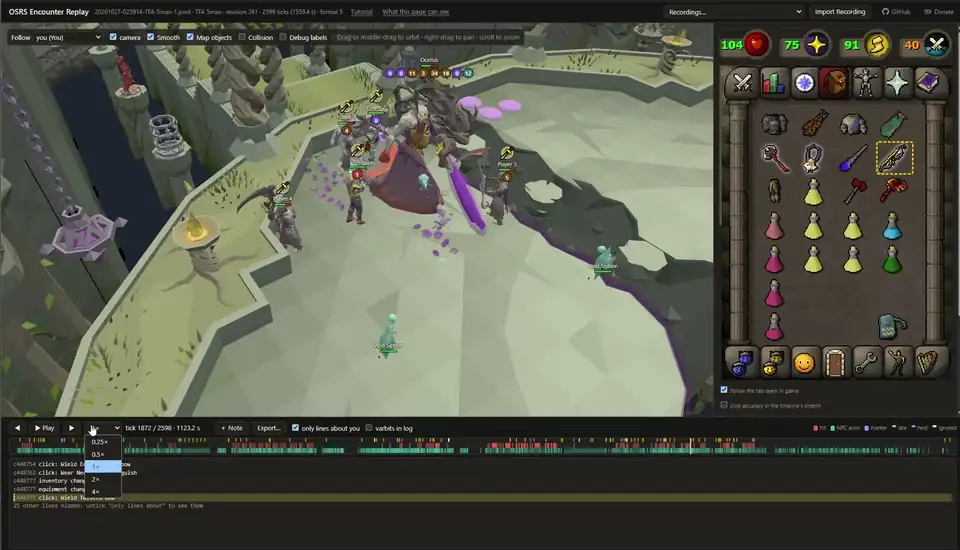
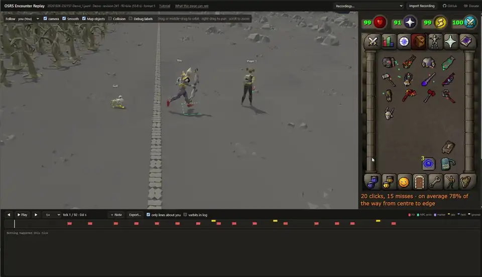
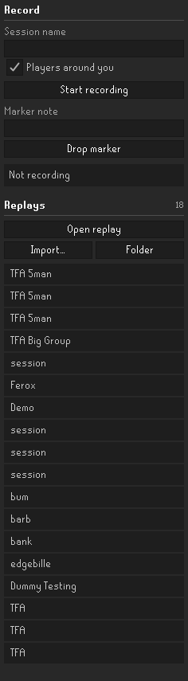
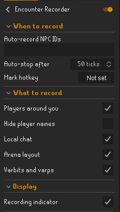

# Encounter Recorder

**Record your Old School RuneScape fights, then play them back tick by tick.**

*Bossing: a 5-man Fractured Archive raid, switching who to follow, with player names hidden.*

## Why

A boss fight is over in seconds, and when it goes wrong you rarely know why. Was the prayer switch
late? Where was everyone standing when the special attack landed? What did you actually click?

Encounter Recorder is a RuneLite plugin that writes down what your game client knew on every tick:
- where every player and NPC stood, and what they were doing;
- every projectile, hitsplat and sound;
- your inventory, gear, prayers and stats;
- the tab you had open, and each click you made, timed to the tick.

[Encounter Replay](https://encounter-replay.pages.dev) plays that back in 3D. You can scrub to any
moment, follow any player and check exactly what state the game was in. Boss fights, raids, PvP, a
skilling trip: anything you can see, you can record.

*PvP: a one-on-one PK fight, with your gear switches, prayers and clicks as they happened.*

## Local, private and free

- **Recordings stay on your computer.** They're plain files in your RuneLite folder, and the plugin
  makes no network requests.
- **The replay runs in your browser, on your own game files.** It draws the game from the copy of the
  game cache RuneLite already keeps on your PC, so no game data is downloaded or hosted.
- **Nothing is uploaded.** The page's security policy blocks it from connecting anywhere but itself, and
  "What this page can see" lists every file it has read.
- **It's free.** There are no accounts, no ads and no subscription.
- **It only records.** Nothing about the fight is shown in game while you play, so it stays within
  Jagex's rules for third-party clients.

## Share a fight

Say you run a clan and you're teaching a new team the Fractured Archive. You turn on auto-record for
the boss, and every attempt saves itself.

After the raid you open the wipe in Encounter Replay and drag across the timeline to pick out the 20
seconds that went wrong. You press **N** to pin notes to the ticks that matter, like "binders spawn
here: north one first". Then you export the stretch with **Hide player names** ticked, which gives you
one small file to post in Discord.

Everyone who opens it on encounter-replay.pages.dev sees the same fight, drawn from their own game
files. Each of them can follow any player, slow it down to a quarter speed and read your notes as they come up.

Streamers can do the same thing:
- **With chat:** walk through a kill after it happens, one tick at a time, showing exactly where the
  damage came from.
- **With viewers:** hand out the file so people can scrub through it themselves.

## Getting started

1. **Install** Encounter Recorder from the RuneLite Plugin Hub (coming soon).
2. **Record.** Name the session in the side panel and press *Start recording*. Or list the boss's NPC
   IDs under *Auto-record NPC IDs*, so recording starts when it appears and stops when it's gone.
   *Drop marker* (or a hotkey) notes moments the game can't know about.
3. **Watch.** Click any recording in the panel's Replays list and it opens in Encounter Replay. The
   first visit walks you through a one-time game cache setup and a short tutorial. It needs a Chromium
   browser (Chrome, Edge, Brave or Opera).

<table>
<tr>
<td align="center"> Record, and every replay in one list</td>
<td align="center"> Choose what gets recorded</td>
</tr>
</table>

Right-click a replay to rename or delete it. **Import…** brings in a recording someone shared with
you. Recordings are saved in `.runelite/plugin-data/encounter-recorder/sessions`.

## What it never records

- **Bank PIN entry:** clicks are dropped while the PIN keypad is open.
- **Private messages, and friends, clan or group chat:** only local chat is recorded, and you can turn
  that off too.
- **Your keyboard.**
- **Anything the game didn't send you:** players and NPCs further than about 15 tiles away.

The file format and the full privacy details are in [docs/FORMAT.md](docs/FORMAT.md).

> **Think before you share.** We deliberately never record your bank PIN, but a recording still holds
> whatever happened while it ran: what you clicked, what was in your inventory and what you said in local
> chat. Please don't share recordings of anything sensitive.

---

Not affiliated with or endorsed by Jagex. RuneScape and Old School RuneScape are trademarks of Jagex Ltd.
